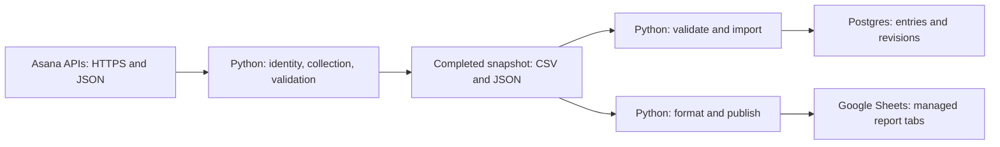
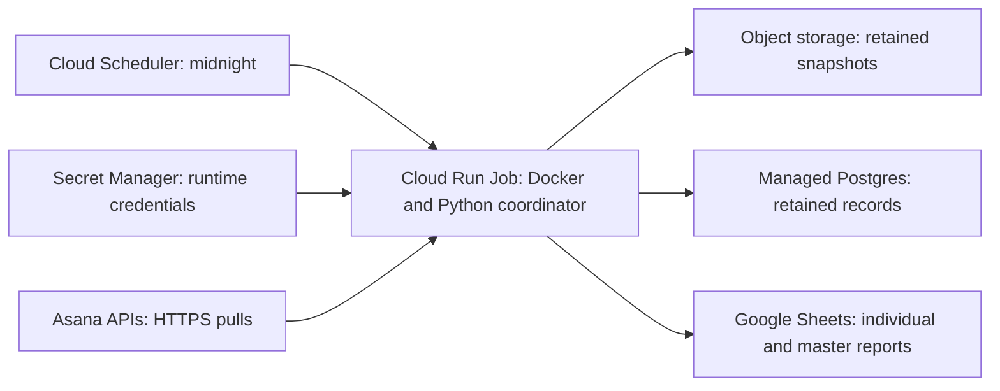
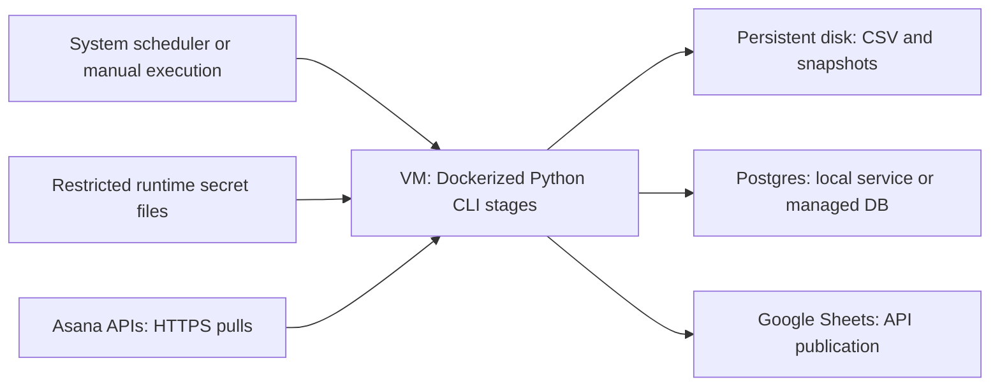
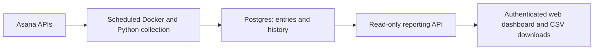

# Asana Reporting architecture and operating guide

Updated October 18, 2026. For technical stakeholders and deployment operators.

## 1. Purpose and implemented functionality

Asana Reporting collects consultants' logged time through Asana's APIs and
produces daily and monthly Actual Time reports. Python performs the collection,
validation, calculations and output processing. CSV files, Postgres storage and
Google Sheets publishing are complementary outputs within one application.
Six consultants are the initial planning scope, with one Asana credential per person.

The application reads Asana; it does not change tasks or time entries or require
an open Asana browser session. Billability, rates, invoice approval and period
locking are separate from reporting logged time.

### Implemented and tested

- Person-specific API collection with credential-owner and date checks.
- Individual entries, daily/monthly summaries and optional task/project context.
- Completed snapshots with reconciliation, metadata and file checksums.
- Postgres imports with stable identity, revisions and replay protection.
- Google Sheets publication to Daily, Monthly, Entries and Status tabs.
- Docker images for the collector and optional database and Sheets tools.

There are 76 automated tests: 67 run offline and nine exercise real Postgres
in CI. Authorized live collection, database imports and connected Sheets refreshes
have also been checked. Secrets and real exports are excluded from Git and builds.

### Operating scope

The tools currently run as separate command-line stages. A six-person coordinator,
renewable Google authentication, changing-date Sheet refreshes, consolidation,
alerts and a web viewer remain implementation work. The deployment designs
distinguish current manual operation from the proposed nightly service.

<!-- pagebreak -->

## 2. API collection and Python processing

Python authenticates to Asana over HTTPS with the consultant's token and reads
JSON responses from the APIs. It verifies the authenticated identity, selects
the workspace and retrieves individual time entries for the requested window.
It follows pagination until the collection is complete. Optional additional
reads add task names and direct/ancestor project context. Operation does not
depend on browser scraping or manually downloading an Asana chart.



**Python performs the application logic.** It checks entry ownership against
the token owner, applies exact work dates, detects duplicate IDs and rejects
conflicting records. It adds integer minutes before calculating hours, builds
daily/monthly reports and checks that all totals agree. The person who recorded
the entry remains separate from the person whose time it represents.

Missing project/task labels do not remove valid owner time. Explicit time
attribution takes priority; other project context is accepted only when
unambiguous. Current memberships do not establish historical project membership.

The Python Postgres importer validates the completed files again and uses the
database driver to write records in a transaction. The Python Sheets publisher
formats the same snapshot into typed cell updates and sends them through
Google's API. Neither consumer has to collect that time from Asana again.
Docker packages the Python components; it does not replace their logic.

<!-- pagebreak -->

## 3. How snapshots are created and reused

A snapshot is one completed observation for a person, workspace and date window.
It records collection time separately from the work dates. It is not an atomic
server-side lock on Asana; avoid editing time during a pull.

### Publication sequence

1. Python collects the API responses and reconciles entry identity, ownership,
   dates, integer minutes and daily/monthly totals.
2. It creates a temporary incomplete directory and writes the CSV/context files.
   Consumers must ignore incomplete directories.
3. It writes a manifest with scope, timestamp, counts, totals, completeness,
   context status and SHA-256 checksums for the five data files. No token is included.
4. After writing finishes, Python renames the directory to a unique completed
   name containing owner/workspace, dates, timestamp and a uniqueness suffix.
   A failed write removes the incomplete directory rather than publishing it.
5. Consumers check completion, hashes, scope and totals before accepting the
   snapshot. Previously completed snapshot directories are not overwritten.

### Files in a completed snapshot

- `entries.csv`: individual entries, owner/creator, minutes and optional context.
- `daily_totals.csv`: machine-readable daily totals, including collected zero days.
- `daily_report.csv`: daily Actual Time in Hours for review.
- `monthly_report.csv`: monthly totals within the requested dates.
- `project_context.json`: project-resolution provenance and statuses.
- `manifest.json`: collection scope, totals, completion and five file checksums.

Checksums detect changed files; they are not digital signatures. Content and
scope validation are also required. Overlapping downloads create new observations,
not additional hours to add together. Stable entry IDs prevent duplicate records.

Stage on a local filesystem with rename guarantees. For object storage, finish
the local snapshot, upload its files under a unique prefix, then publish a
separate completion marker only after upload succeeds. This upload stage is
proposed work; the current CLI does not automatically retain files in cloud storage.

<!-- pagebreak -->

## 4. File outputs and Postgres storage

CSV-only execution requires Python and an Asana token, without a database or
Google credential. Open completed reports in Excel, Sheets or other tools.
Import long IDs as text. Monthly figures cover the requested dates; a partial
month is not a full-month total.

Mount a persistent host directory for container output. The supplied collector
Compose file does this. A cloud worker's temporary disk is not a retained archive.

### How information enters Postgres

The Python importer verifies the completed snapshot and stores entries, collection
runs, observation timestamps and before/after revisions. Record identity is the
workspace plus entry ID. A duration or date correction updates that record
instead of creating extra hours. Re-importing the exact snapshot makes no changes.
Each import commits or rolls back as a transaction.

An entry absent from a later comparable successful collection remains flagged
as unseen and retained for review. A permissions change can resemble deletion.
Current provisional totals retain those entries; a failed pull never establishes
deletion. Successfully collected zero days remain distinct from uncollected days.

The supplied Compose database is a development configuration with a persistent
volume and no host-published DB port. Production requires a restricted application
role, verified TLS for remote connections, approved persistent storage, backups
and a demonstrated restore. A disk volume alone is not a backup.

### Using the outputs together

Collect once to create the CSV snapshot, then optionally import that directory
into Postgres and publish it to Sheets. The database CLI currently produces daily
CSV for one owner. A consolidated Postgres-to-Sheets reporting adapter remains
additional work; the present Sheets publisher reads snapshots directly.

Use Postgres for retained history and a future web viewer. Snapshots and Sheets
can support an initial supervised rollout without a database if their retention
and correction policy is explicit. See [Postgres operations](postgres.md).

<!-- pagebreak -->

## 5. Google Sheets and consolidation

The Python publisher sends typed values to Daily, Monthly, Entries and Status
tabs. IDs/names are text, while minutes and hours are numeric. One Google batch
replaces managed values and clears old trailing rows. Exact readback checks the
result. Repeated publication does not append duplicate hours.

Keep notes/formulas on separate tabs: managed ranges are replaced during a
refresh. The current contract accepts one owner, workspace and exact date window
per workbook. Changing the date window requires the planned refresh/history policy.

### Google setup

Create or select a company-owned native Sheet, grant the writer Editor access
and initialize the supported report tabs and Status metadata through the connected
spreadsheet creation workflow. The CLI refreshes initialized workbooks; it does
not create/share Drive files. An Asana token cannot authenticate to Google.

A service account can receive access to specific workbooks without domain-wide
delegation, subject to Workspace sharing policies. An approved company user's
OAuth integration is another option. The CLI accepts a short-lived Google access-token
file and does not renew it. The connected-account test did not provision cloud
runtime credentials. [Google credential guidance](https://developers.google.com/workspace/guides/create-credentials).

### Master dashboard

A proposed coordinator would publish the six owners' normalized entries to one
master workbook, with per-owner source timestamps and coverage. Formulas, pivots
and charts can summarize hours by person, day, week, month and project. Account
reporting requires an explicit project-to-account mapping.

Alternatively, use bounded IMPORTRANGE connections to individual reports. Each
source needs an access grant and updates can be delayed. Direct coordinated
publication gives more control over completeness.
[IMPORTRANGE behavior](https://support.google.com/docs/answer/3093340).

Neither consolidation approach is implemented. Show a failed source as stale,
not zero. A successful DB import and a Google write are separate outcomes;
there is no transaction across both services or six workbooks. Track and retry
each output stage independently. See [Sheets operations](sheets.md).

<!-- pagebreak -->

## 6. Docker and the managed deployment target

Docker packages Python, application code and the selected dependencies into
repeatable images. Supply secrets and output storage at runtime. Each image
executes one command and exits; no listening web service is needed.

- `Dockerfile`: dependency-free collector, with Python included.
- `Dockerfile.postgres`: database tool with pinned Psycopg dependencies.
- `Dockerfile.sheets`: publisher and snapshot validator, without a DB driver.

These are component images of one application. Postgres is a separate service.
Mount secret files and output locations rather than putting them into an image.



**Proposed managed architecture.** The coordinator and object-storage upload
stage are not implemented. The job would start at 00:00 in America/El_Salvador,
collect through yesterday and refresh an agreed correction window. Set both
scheduler and application timezones. Define handling for all open billing periods
and older corrections; a 60-day lookback alone is not retained history.

Retained snapshots and Postgres must live outside the disposable worker. Budget
for job compute, secrets, storage, logs and any database/backups. No cloud
resources are provisioned by this repository.
[Scheduled Cloud Run jobs](https://docs.cloud.google.com/run/docs/execute/jobs-on-schedule).

<!-- pagebreak -->

## 7. Setting up the cloud deployment

These steps assume you manage the project and can deploy workloads, grant
scoped permissions, create identities and configure networking.

1. Choose an approved project, region and billing account. Enable Cloud Run,
   Artifact Registry, Cloud Scheduler, Secret Manager, object storage and the
   Google Sheets API for publication.
   Add managed Postgres if retained database history is selected.
2. Create the image registry and private snapshot storage. Configure retention,
   backup requirements, permitted outbound connectivity and database access.
3. Create separate scheduler and worker identities. The scheduler can invoke
   this job. The worker can read its designated secrets and write to its approved
   file, database and Google reporting destinations.
4. Provision each person's Asana secret and expected owner/workspace map. Grant
   the Google writer access to the workbooks. Implement credential acquisition
   and renewal rather than scheduling a copied expiring Google token.
5. Complete the coordinator, snapshot upload, rolling-date/history policy,
   master publication, execution lock, alerts and stage recovery. These are
   application changes, not existing features enabled by a cloud setting.
6. Build the coordinator image for the selected runtime architecture, push it
   to the registry and deploy the job with its runtime identity, secret mounts,
   reporting timezone, resource limits and bounded execution timeout.
7. Execute manually. Reconcile all six sources, repeat the run, test a late edit,
   an expired credential and a failed destination. Verify retained files,
   visible partial status, alert delivery and restoration where applicable.
8. Enable `0 0 * * *` in America/El_Salvador after acceptance. Monitor completion
   and report freshness; successful job invocation does not mean the batch finished.

Cloud Run can mount secrets as files, matching the token-file interface. Current
images still invoke individual tools, not a coordinator. Container-local output
must be retained before job exit.
[Cloud Run job secrets](https://docs.cloud.google.com/run/docs/configuring/jobs/secrets).

### Deployable today

For supervised operation, create an approved Linux cloud VM with Docker and a
persistent encrypted disk. Clone the repository, mount secrets and output
directories, and run the existing CLI stages shown below. A managed Postgres
connection can replace the local development database. Full six-person nightly
operation still needs orchestration, renewable Google credentials and a Sheet
window policy. The next diagram shows the VM alternative.

<!-- pagebreak -->

## 8. Server or VM deployment architecture



Create an approved Linux VM, attach persistent report/database storage and
configure restricted administrative access. Install Docker Engine and Compose,
then clone the private repository using an authorized GitHub account. Follow
the Linux/Docker instructions below. Keep secret files outside the checkout.

First collect one owner's snapshot manually. Inspect its manifest and daily
report, initialize/import to Postgres if selected, then initialize/refresh the
Google workbook. Verify each output before adding the remaining credentials.
Use separate owner configurations and explicit identity checks.

A systemd timer or cron job can later invoke an operator-maintained runner. It
must select completed snapshots, serialize executions, record per-owner outcomes,
preserve last-good data and retry output stages safely. Do not point six
independent Sheets writers at the same managed tabs. The application does not
install the runner or scheduler automatically.

A new VM adds patching, disk capacity, monitoring, secret protection and backup
responsibilities. An existing approved server may reuse its operating arrangements.
Cloud Run avoids VM upkeep; application operation and retained-data management
remain necessary in either design.

For native Postgres commands use the pinned optional dependencies in a virtual
environment. The Postgres image is the simpler consistent runtime. Its supplied
Compose database is a development stack, not a production security configuration.
See [deployment detail](deployment.md), [Docker](docker.md) and [Postgres](postgres.md).

<!-- pagebreak -->

## 9. Prerequisites and Asana token setup

### Prerequisites

- Private-repository access and Git, or an approved source archive.
- Python 3.10+ for native execution. CSV and Sheets need no extra Python packages;
  database commands need the optional driver.
- Alternatively, Docker with Linux containers and Compose. Docker images include
  Python, so Docker-only execution does not require host Python.
- An Asana account authorized to access its own time and the intended workspace,
  with permission to create/use a personal access token.
- Private writable output storage and working HTTPS certificate trust.
- For optional outputs: Postgres access/credentials, or an initialized Google
  Sheet plus a separate Google writer credential.

### Obtain and store the Asana token

1. Sign in as the person whose time will be collected. Open the
   [Asana developer console](https://app.asana.com/0/my-apps).
2. Select **Create new token**, give it a descriptive name such as Asana Reporting,
   and create it. Copy the value while displayed; it is shown only once.
3. Save it in an approved secret manager or a plain UTF-8 file outside the
   repository. The file contains only the token, optionally followed by a newline.
   Restrict access to the operator/runtime identity.
4. Supply its path with `--token-file`, never the token value as a command argument.
   For six people, provision distinct credentials and verify each expected owner.

The console is also accessible through profile settings, Apps, Manage Developer
Apps. If token creation is unavailable, the Asana administrator must approve an
allowed integration. Tokens act with their owner's access even though this code
only reads Asana. Review/revoke unused tokens through Asana.
[Token setup](https://developers.asana.com/docs/quick-start),
[PAT security](https://developers.asana.com/docs/personal-access-token).

Linux/macOS examples use `$HOME/.config/asana-reporting/asana.token`. Windows
examples use `%USERPROFILE%\.asana-reporting\asana.token`. Save it with an
approved editor, restrict its permissions and never include it in reports.

<!-- pagebreak -->

## 10. Running on Linux or macOS

Install Git and an approved Python 3.10+ interpreter. On Linux use supported
distribution packages. On macOS use an approved Python installer/package manager
rather than assuming the system Python is suitable.

```bash
git clone https://github.com/Nobody5252/asana-reporting.git
cd asana-reporting
python3 --version
python3 asana_time_export.py --help
mkdir -p "$HOME/.config/asana-reporting"
chmod 700 "$HOME/.config/asana-reporting"
```

Save the token file, then restrict it and identify the owner/workspace:

```bash
chmod 600 "$HOME/.config/asana-reporting/asana.token"
python3 asana_time_export.py \
  --token-file "$HOME/.config/asana-reporting/asana.token" \
  --list-workspaces
```

Use the numeric owner and workspace IDs returned by that command to replace
the uppercase placeholders below:

```bash
python3 asana_time_export.py \
  --token-file "$HOME/.config/asana-reporting/asana.token" \
  --expected-owner OWNER_GID --workspace WORKSPACE_GID \
  --days 30 --end yesterday --include-tasks \
  --output ./asana-exports-v2 --non-interactive
```

Open `daily_report.csv` and `manifest.json` inside the completed directory printed
by the tool. Omit `--include-tasks` when labels are unnecessary. Relative dates
follow the host calendar; use explicit `--start` and `--end` if the report
timezone differs from the machine's timezone.

For Docker-only Linux use Docker Engine and Compose with authorized daemon
access. On macOS install approved Docker Desktop for Apple Silicon or Intel,
start it and permit access to the token/output directories.
[Linux installation](https://docs.docker.com/engine/install/),
[macOS installation](https://docs.docker.com/desktop/setup/install/mac-install/).

<!-- pagebreak -->

## 11. Running on Windows

Install Git and an approved Python 3.10+ interpreter accessible from PowerShell.
Use `python`, or substitute its installed path. The `py` launcher is optional.
Native Python CSV execution does not require WSL.

```powershell
git clone https://github.com/Nobody5252/asana-reporting.git
Set-Location asana-reporting
python --version
python asana_time_export.py --help
$secretDir = Join-Path $env:USERPROFILE ".asana-reporting"
New-Item -ItemType Directory -Force $secretDir
$token = Join-Path $secretDir "asana.token"
```

Use an approved editor to save only the token to `$token` as UTF-8. Ensure the
file is named `asana.token`, not `asana.token.txt`. Restrict access through
Windows file Security permissions, then identify the owner/workspace:

```powershell
python asana_time_export.py --token-file $token --list-workspaces
```

Replace the IDs and example dates with the intended reporting window. A
PowerShell continuation backtick must have no trailing spaces.

```powershell
python asana_time_export.py --token-file $token `
  --expected-owner OWNER_GID --workspace WORKSPACE_GID `
  --start 2026-10-01 --end 2026-10-17 `
  --include-tasks --output .\asana-exports-v2 --non-interactive
```

The output files match Linux/macOS execution. Explicit dates avoid depending
on the Windows machine's local reporting calendar.

For Docker, install approved Docker Desktop, select Linux containers and satisfy
its supported Windows/WSL 2 or Hyper-V requirements, including virtualization.
Start it and verify `docker version` and `docker compose version`. From WSL use
the Linux instructions and paths consistently; do not mix PowerShell/WSL paths.
[Windows Docker requirements](https://docs.docker.com/desktop/setup/install/windows-install/).

Linux execution has been validated. Windows/macOS paths require a local
acceptance run with the host's trust and file-sharing configuration.

<!-- pagebreak -->

## 12. Running the Docker collector

From the repository directory, supply an existing token file and a persistent
host output directory. Compose mounts the token and supplies its internal path.
The secret value is not baked into the image.

### Linux or macOS shell

```bash
export ASANA_TOKEN_FILE="$HOME/.config/asana-reporting/asana.token"
export LOCAL_UID="$(id -u)"
export LOCAL_GID="$(id -g)"
mkdir -p asana-exports-v2
docker compose build
docker compose run --rm exporter --list-workspaces
docker compose run --rm exporter \
  --expected-owner OWNER_GID --workspace WORKSPACE_GID \
  --days 30 --end yesterday --include-tasks
```

### Windows PowerShell

Assuming `$token` was set as shown in the Windows section:

```powershell
$env:ASANA_TOKEN_FILE = $token
New-Item -ItemType Directory -Force .\asana-exports-v2
docker compose build
docker compose run --rm exporter --list-workspaces
docker compose run --rm exporter `
  --expected-owner OWNER_GID --workspace WORKSPACE_GID `
  --days 30 --end yesterday --include-tasks
```

The supplied collector container uses America/El_Salvador. Completed snapshots
remain in the host's `asana-exports-v2` after it exits. The runtime is non-root,
with a read-only filesystem apart from the mounted output. UID/GID settings
align Linux/macOS host permissions; Docker Desktop may also need file-sharing
configuration for mounts.

Correct file permissions, identity mismatches or connectivity failures before
publishing a report. Keep TLS verification enabled. See [Docker operations](docker.md)
for direct Docker commands, platform permissions and image archives.

<!-- pagebreak -->

## 13. Importing a snapshot and publishing it

### Postgres setup and import

Follow [Postgres setup](postgres.md) to create the local password file, set
`ASANA_PG_PASSWORD_FILE` and host identity variables, create output directories,
build the image, start the DB and apply the schema. Then use the directory
printed by the collector:

```bash
docker compose -f compose.postgres.yaml run --rm store import-snapshot \
  /snapshots/COMPLETED_SNAPSHOT_DIRECTORY \
  --expected-owner OWNER_GID --workspace WORKSPACE_GID
docker compose -f compose.postgres.yaml run --rm store report \
  --owner OWNER_GID --workspace WORKSPACE_GID \
  --start 2026-10-01 --end 2026-10-17 --output /data/daily.csv
```

These multiline commands use a Linux/macOS or VM/WSL shell. In PowerShell enter
each command on one line or replace the continuation backslashes with backticks.
For a managed remote DB configure `PGHOST`, `PGDATABASE`, `PGUSER`,
`PGPASSWORD_FILE` and verified TLS. Provision a restricted production role
separately from the development bootstrap role.

### Google Sheets setup and refresh

Initialize a dedicated native workbook through the connected spreadsheet creation
workflow, grant the writer Editor access and obtain an approved Google access-token
file. Use the actual snapshot directory and spreadsheet ID:

```bash
python3 asana_sheets.py /private/snapshots/COMPLETED_RUN \
  --expected-owner OWNER_GID --workspace WORKSPACE_GID \
  --spreadsheet-id GOOGLE_SPREADSHEET_ID \
  --access-token-file /private/secrets/google-access-token
```

On Windows use `python`, Windows paths and the appropriate shell continuation.
For Docker build `Dockerfile.sheets` and mount the snapshot and Google secret as
described in [Sheets operations](sheets.md). The CLI checks destination scope,
replaces managed data and verifies readback. An Asana token cannot be used here.
Token renewal and rolling-date refresh remain requirements for unattended operation.

<!-- pagebreak -->

## 14. Optional web dashboard and rollout

Google Sheets can be the first dashboard. A future website would read retained
Postgres data through a reporting API rather than contact six Asana accounts
whenever someone opens a page.



The proposed site would provide person/date/project/account filters, daily,
weekly/monthly hours, CSV downloads and collection coverage. Add company-approved
sign-in and viewer authorization. Consultant tokens remain in the background
worker, never browser code. Account reporting requires a maintained mapping.

The reporting API, website and authentication service are not implemented.
They add hosting, monitoring, access management and dependency maintenance.

### Implementation order

1. Validate native or Docker execution for one owner and reconcile snapshot totals.
2. Configure approved persistence/reporting destinations and exercise imports,
   repeat publication and restore/recovery where selected.
3. Complete orchestration, renewable Google authentication, rolling-date/history
   handling and consolidation. Test all six owners and partial failures.
4. Deploy the VM runner or managed job, verify alerts and overlap prevention,
   then enable the midnight schedule.
5. Add the optional web viewer after dependable daily reporting.

Operational acceptance includes correct identities/totals, no duplicate hours
on replay, handling for late corrections, visible stale sources, renewable and
revocable credentials, durable snapshots, database restoration where selected
and recovery of a failed destination stage. Continue with
[engineering deployment requirements](deployment.md).
